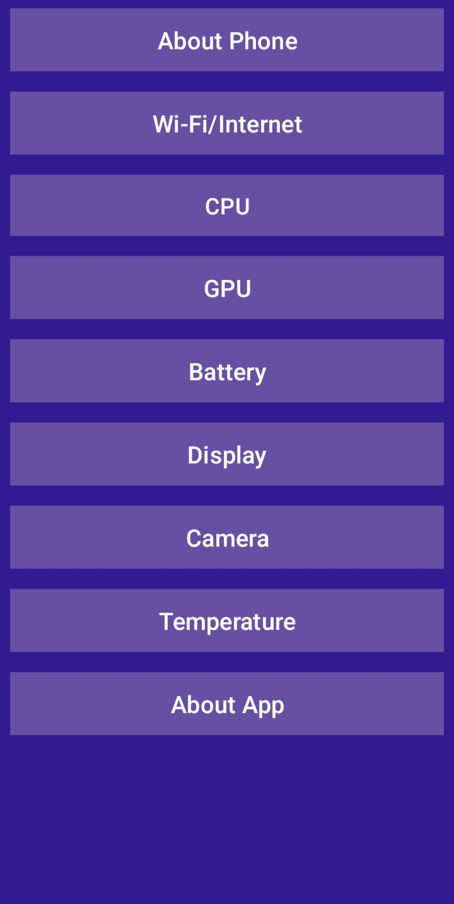
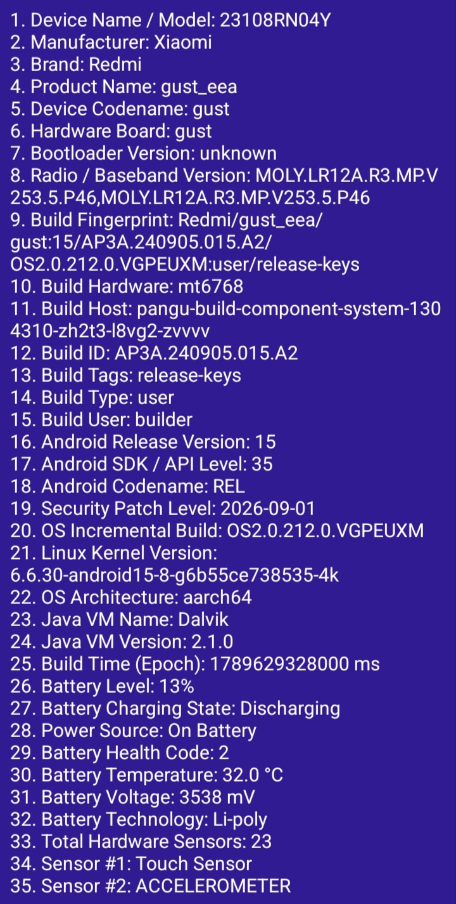
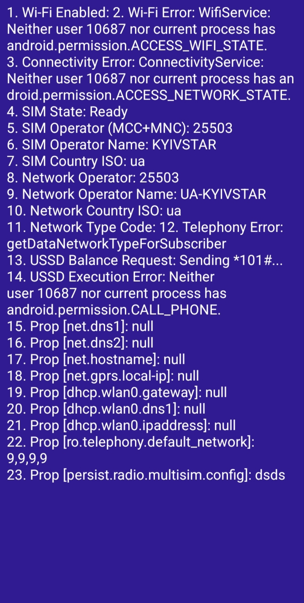
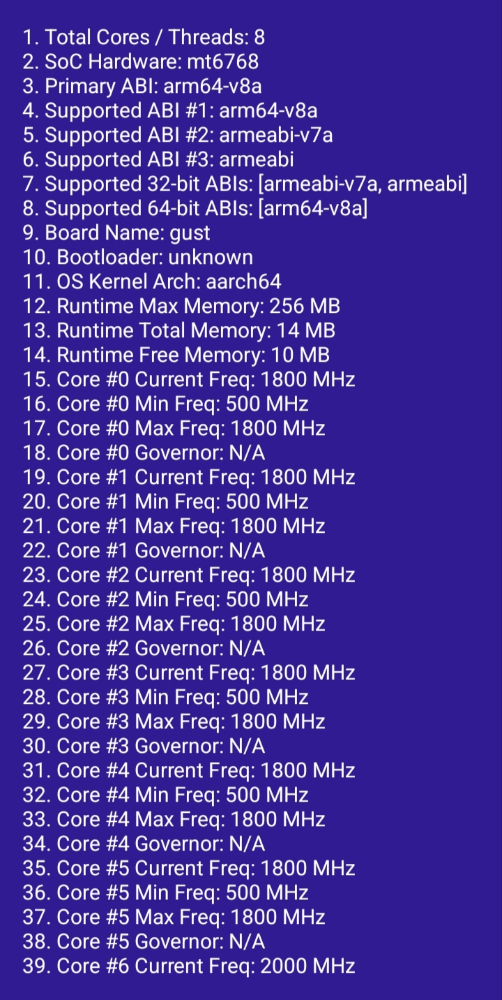
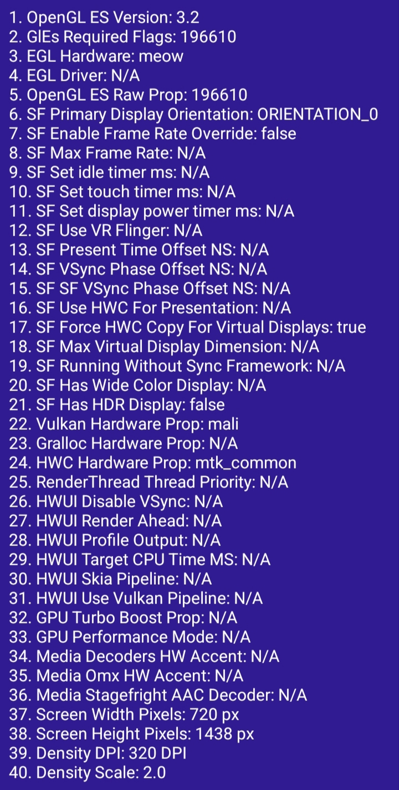
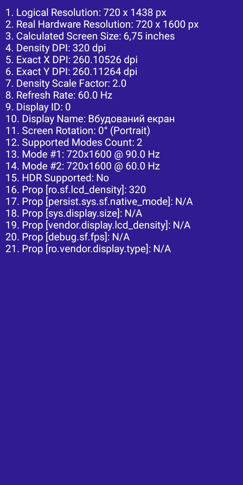
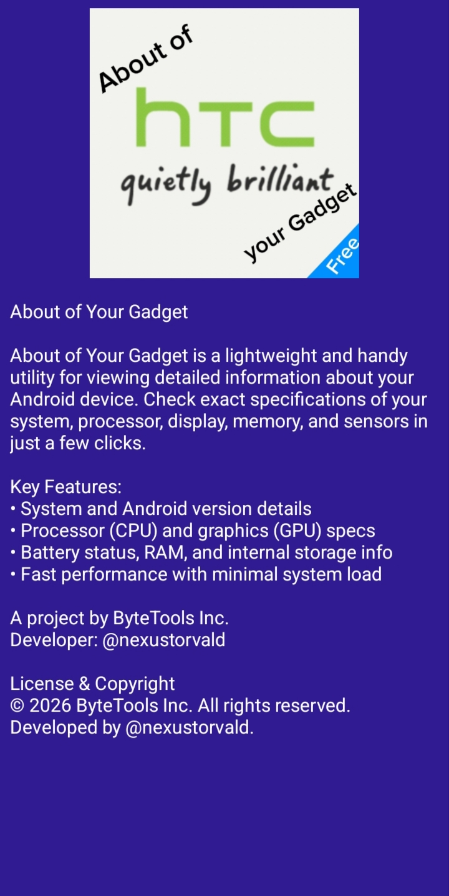

  
  <h1>About of your Gadget</h1>
  
🌐   
🌐 <strong>Язык:</strong> <a href="README.md">English</a> | <a href="README-UA.md">Українська</a> | <strong>Русский</strong>

  

    
    
    
    
  

**About of your Gadget** (`com.bytetools.aboutgadget`) — это лёгкая системная утилита для Android, предназначенная для просмотра подробных характеристик оборудования и мониторинга температуры смартфона или планшета в реальном времени.

---

## Скриншоты

| | | |
| :---: | :---: | :---: |
|  |  |  |
|  |  |  |
|  |  |  |

---

## Основные возможности

- **Мониторинг температуры в реальном времени:** отслеживание нагрева аккумулятора и компонентов устройства.
- **Характеристики системы и «железа»:** подробная информация о процессоре (CPU), графическом ускорителе (GPU), оперативной и встроенной памяти, экране и сборке Android.
- **Малый вес и высокая скорость:** компактный размер (~6.2 МБ), оптимизированный как для современных, так и для старых устройств на базе **Android 5.0 (Lollipop)** и выше.
- **Простой и понятный интерфейс:** быстрая диагностика без лишних фоновых процессов.

---

## Скачать

Загрузите официальный APK-файл напрямую с **APKPure** или из раздела **GitHub Releases**:

[-34B161?style=for-the-badge&logo=android&logoColor=white)](https://apkpure.com/ru/about-of-your-gadget/com.bytetools.aboutgadget)

- **Имя пакета:** `com.bytetools.aboutgadget`
- **Минимальная версия ОС:** Android 5.0+
- **Размер APK:** 6.2 МБ
- **Официальная страница на APKPure:** [About of your Gadget на APKPure](https://apkpure.com/ru/about-of-your-gadget/com.bytetools.aboutgadget)

---

## Установка

1. Скачайте `.apk` файл со страницы **APKPure** или из вкладки **Releases** выше.
2. Откройте загруженный файл на вашем Android-устройстве.
3. При необходимости разрешите установку приложений из неизвестных источников в настройках браузера или системы.
4. Нажмите **Установить** и запустите **About of your Gadget**.

---

## История изменений

### v1.0 (19 ноября 2026)
- Первый публичный релиз.
- Добавлена базовая диагностика характеристик устройства и мониторинг температуры в реальном времени.
- Приложение опубликовано на APKPure (статус Partner Developer) и в GitHub Releases.

---

## Разработчик

Разработано и поддерживается **ByteTools Inc.**
