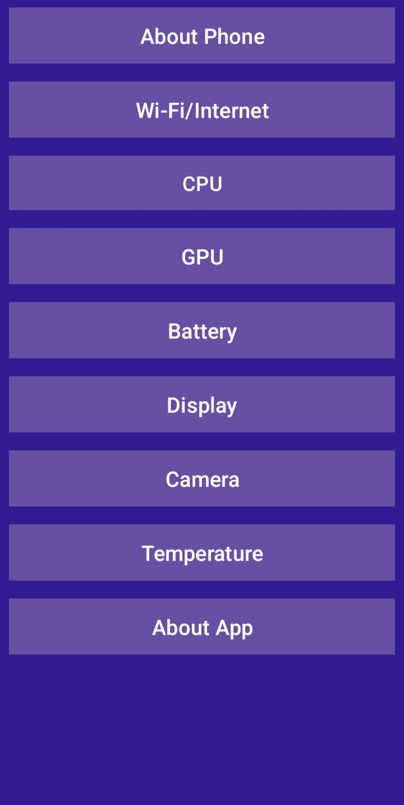
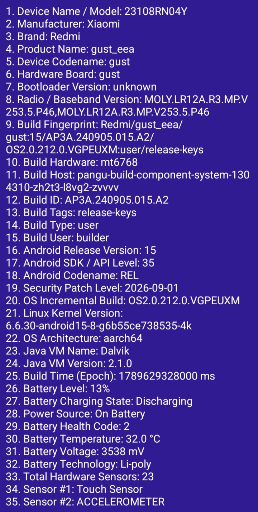
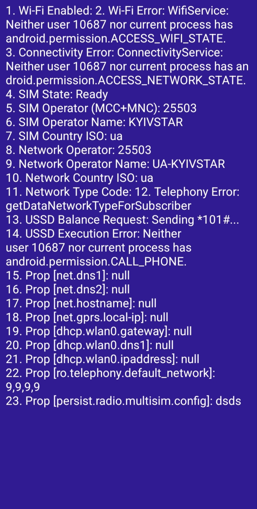
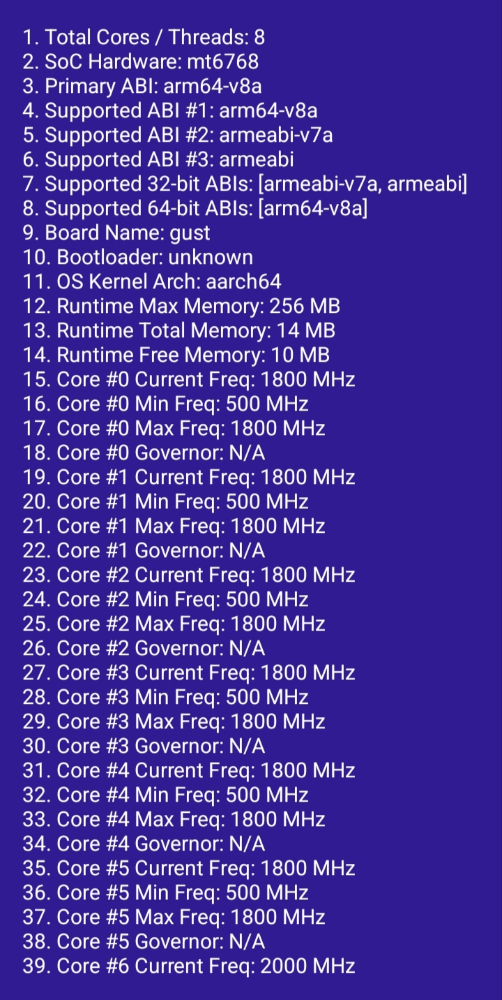
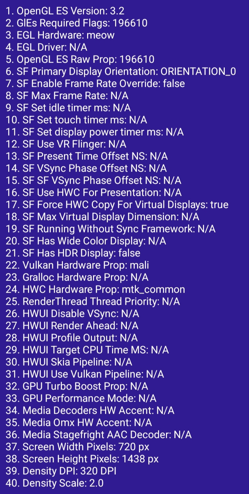
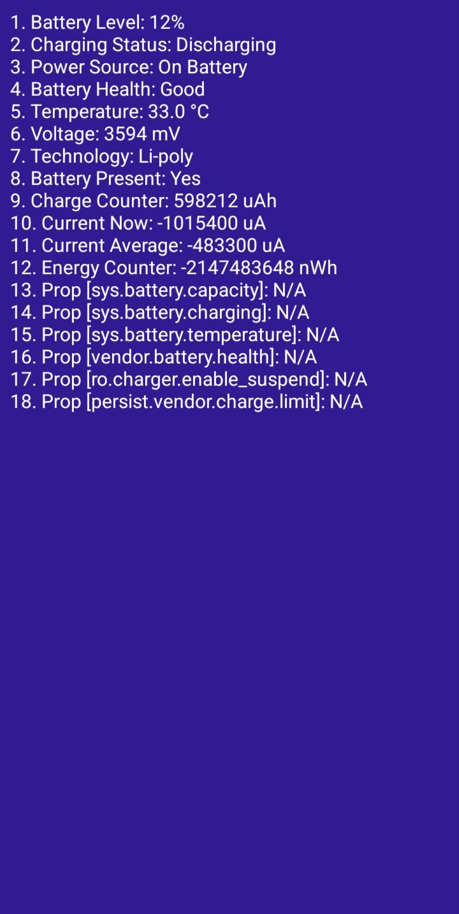
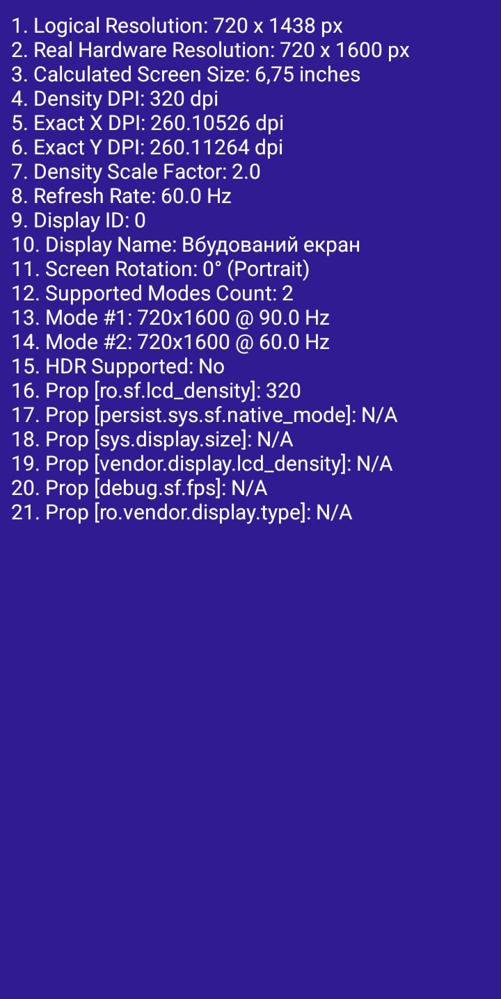
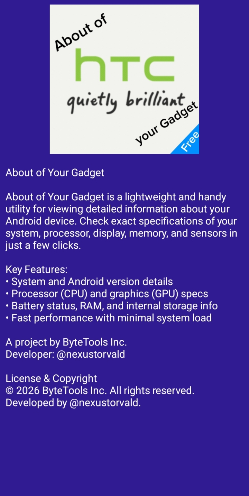

  
  <h1>About of your Gadget</h1>
  
🌐 <strong>Мова:</strong> <a href="README.md">English</a> | <strong>Українська</strong> | <a href="README-RU.md">Русский</a>

  

    
    
    
    
  

**About of your Gadget** (`com.bytetools.aboutgadget`) — це легка системна утиліта для Android, створена для перегляду детальних характеристик обладнання та моніторингу температури смартфона або планшета в реальному часі.

---

## Скріншоти

| | | |
| :---: | :---: | :---: |
|  |  |  |
|  |  |  |
|  |  |  |

---

## Основні можливості

- **Моніторинг температури в реальному часі:** відстеження нагріву акумулятора та компонентів пристрою.
- **Характеристики системи та «заліза»:** детальна інформація про процесор (CPU), графічний прискорювач (GPU), оперативну та вбудовану пам'ять, екран і збірку Android.
- **Мала вага та висока швидкість:** компактний розмір (~6.2 МБ), оптимізований як для сучасних, так і для старіших пристроїв на базі **Android 5.0 (Lollipop)** і вище.
- **Простий і зрозумілий інтерфейс:** швидка діагностика без зайвих фонових процесів.

---

## Завантажити

Завантажте офіційний APK-файл напряму з **APKPure** або з розділу **GitHub Releases**:

[-34B161?style=for-the-badge&logo=android&logoColor=white)](https://apkpure.com/ru/about-of-your-gadget/com.bytetools.aboutgadget)

- **Ім'я пакета:** `com.bytetools.aboutgadget`
- **Мінімальна версія ОС:** Android 5.0+
- **Розмір APK:** 6.2 МБ
- **Офіційна сторінка на APKPure:** [About of your Gadget на APKPure](https://apkpure.com/ru/about-of-your-gadget/com.bytetools.aboutgadget)

---

## Встановлення

1. Завантажте `.apk` файл зі сторінки **APKPure** або з вкладки **Releases** вище.
2. Відкрийте завантажений файл на вашому Android-пристрої.
3. За потреби дозвольте встановлення додатків із невідомих джерел у налаштуваннях браузера або системи.
4. Натисніть **Встановити** та запустіть **About of your Gadget**.

---

## Історія змін

### v1.0 (19 листопада 2026)
- Перший публічний реліз.
- Додано базову діагностику характеристик пристрою та моніторинг температури в реальному часі.
- Додаток опубліковано на APKPure (статус Partner Developer) та в GitHub Releases.

---

## Розробник

Розроблено та підтримується **ByteTools Inc.**
