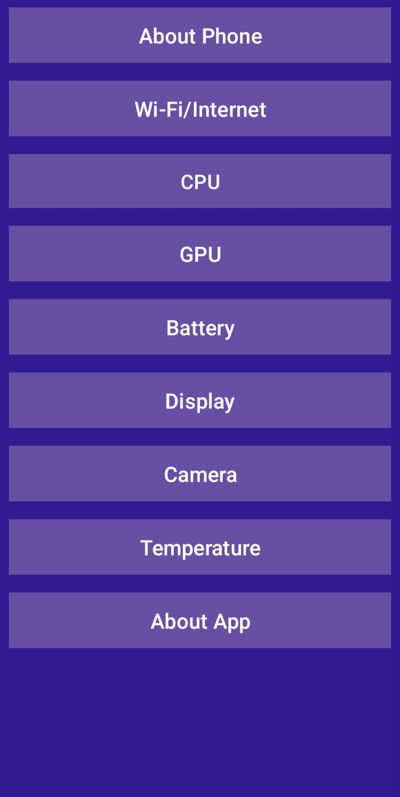
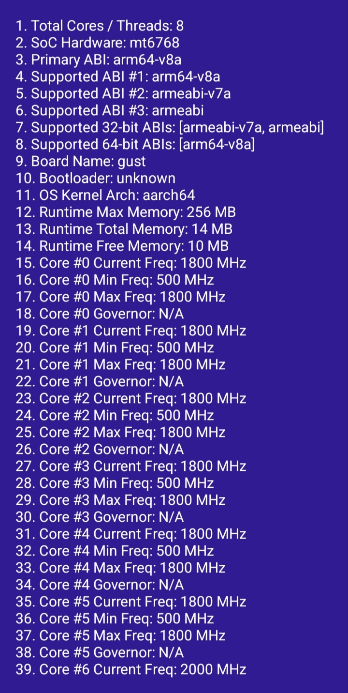
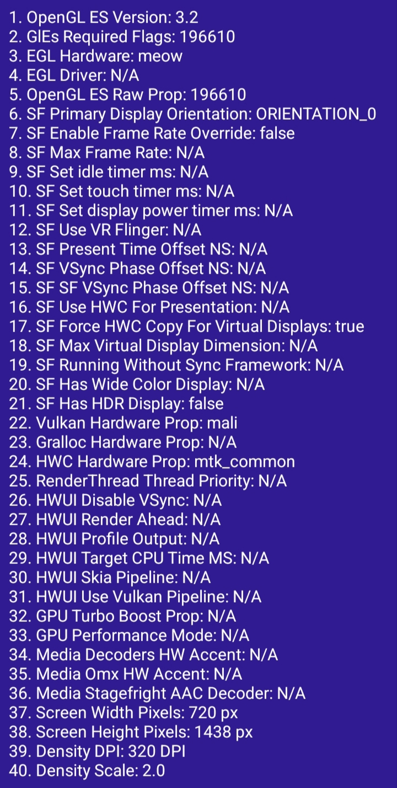
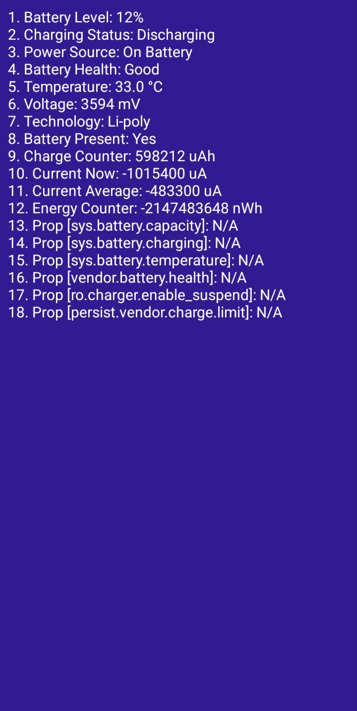
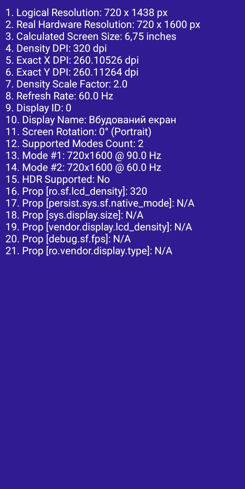
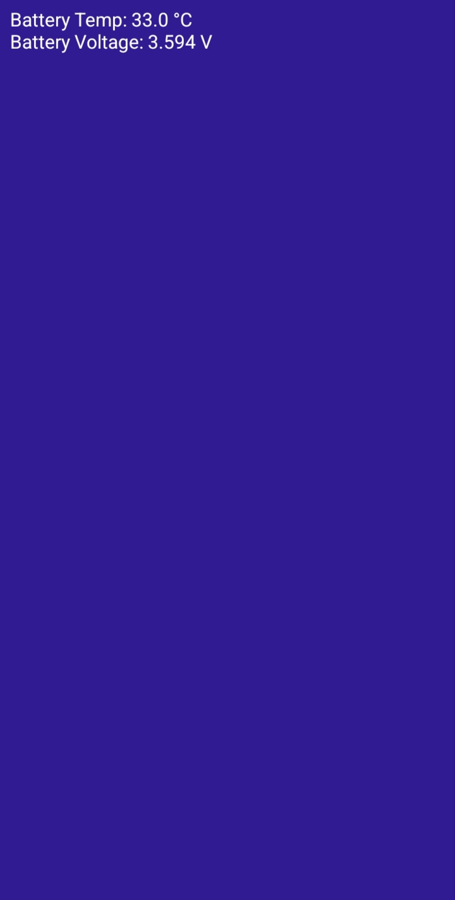
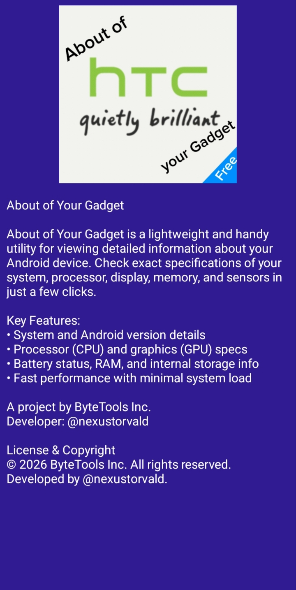

# About of Your Gadget 📱

  <a href="README.md">English</a> | <a href="README-RU.md">Русский</a>

  

  <b>A lightweight and convenient system monitor for Android devices (API 21+), built with Sketchware Pro.</b>

---

## 🚀 Key Features
* **Real-time Hardware Monitoring:** Track battery temperature and CPU thermal zones in real-time.
* **System & Power Info:** Battery voltage and core device parameters.
* **Optimized Architecture:** Clean Java code utilizing safe background threads (`Handler`).

---

## 📸 App Screenshots

  
  
  
  
  
  
  
  

---

## 🛠 Tech Stack
* **Platform:** Sketchware Pro / AndroidX
* **Language:** Java
* **Min SDK:** Android 5.0+ (API 21+)

## 📥 Download
You can download the latest APK release in the **[Releases](../../releases)** section.
