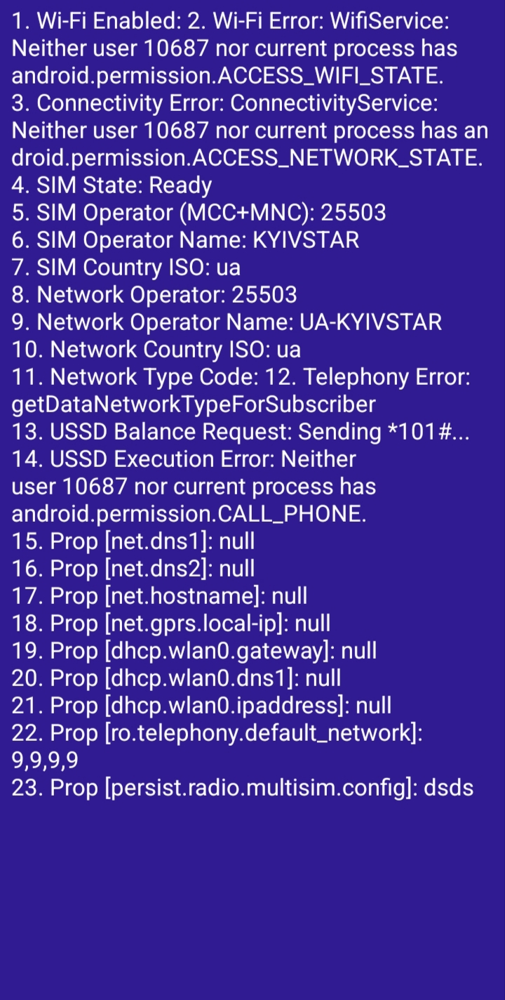

  
  <h1>About of your Gadget</h1>
  
🌐   
🌐 <strong>Language:</strong> <strong>English</strong> | <a href="README-UA.md">Українська</a> | <a href="README-RU.md">Русский</a>

  

  

    
    
    
    
  

**About of your Gadget** (`com.bytetools.aboutgadget`) is a lightweight Android system utility designed to provide detailed hardware specifications and real-time temperature monitoring for your smartphone or tablet.

---

## Screenshots

| | | |
| :---: | :---: | :---: |
|  |  |  |
|  |  |  |
|  |  |  |

---

## Features

- **Real-Time Temperature Monitoring:** Track battery and device thermal status in real time.
- **Hardware & System Specifications:** View detailed information about your CPU, GPU, RAM, storage, display, and Android OS build.
- **Lightweight & Fast:** Minimal footprint (~6.2 MB) optimized for both modern and legacy devices running **Android 5.0 (Lollipop)** and higher.
- **Clean Interface:** Straightforward layout for quick diagnostics without unnecessary background bloat.

---

## Download

Get the official APK directly from **APKPure** or via **GitHub Releases**:

[-34B161?style=for-the-badge&logo=android&logoColor=white)](https://apkpure.com/ru/about-of-your-gadget/com.bytetools.aboutgadget)

- **Package Name:** `com.bytetools.aboutgadget`
- **Minimum OS:** Android 5.0+
- **APK Size:** 6.2 MB
- **Official APKPure Page:** [About of your Gadget on APKPure](https://apkpure.com/ru/about-of-your-gadget/com.bytetools.aboutgadget)

---

## Installation

1. Download the `.apk` file from **APKPure** or the **Releases** tab above.
2. Open the downloaded file on your Android device.
3. If prompted, allow installation from unknown sources in your device or browser settings.
4. Tap **Install** and launch **About of your Gadget**.

---

## Changelog

### v1.0 (November 19, 2026)
- Initial public release.
- Added core hardware diagnostics and real-time device temperature monitoring.
- Published on APKPure (Partner Developer) and GitHub Releases.

### v1.1 (November 22, 2026)
- Initial public release.
- Added a new button "Memory"
- Also changed simple buttons to Material Button.
---

## Developer

Developed and maintained by **ByteTools Inc.**
